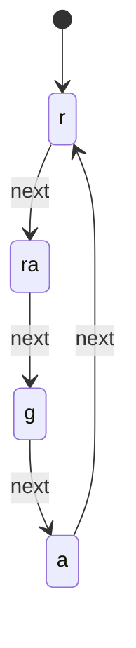

# One-Way Traffic Light (Without Control)

* Starts immediately in `:r` (red) as required by R7 and cycles continuously on `:next` events (R4, R6, R8).
* `:run` and `:halt` events are intentionally omitted because R9 and R10 do not apply to this configuration.