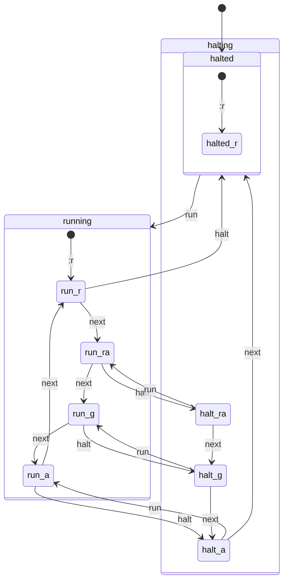

# One-Way Traffic Light (Controlled)

* **Graceful Halt (R10 & R4):** Sending `:halt` while active (`:ra`, `:g`, or `:a`) enters a `halting` mirror of the active colour rather than snapping directly to `:r`, ensuring `:g` always passes through `:a` on subsequent `:next` events (R4, R6).
* **Resumability (R9):** Sending `:run` at any point—whether in `halted` or mid-shutdown in `halting`—returns the controller to `running` without losing its current light phase.