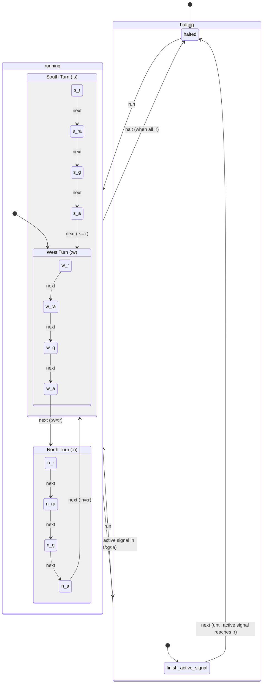

# Three-Way Coordinated Traffic Lights (`:w`, `:n`, `:s`)

* **Mutual Exclusion & Safety (R2, R5):** Only one signal (`:w`, `:n`, or `:s`) is active in a turn at any time while the other two remain strictly locked at `:r`, preventing overlapping green or amber lights.
* **Equitable Interleaving & Minimal Wait (R3, R8):** Turns rotate in a strict round-robin (`:w` $\rightarrow$ `:n` $\rightarrow$ `:s` $\rightarrow$ `:w`) with zero idle all-red steps between turns (12 `:next` events for a complete 3-way cycle).
* **Graceful Halt (R10):** If `:halt` is received while any signal is `:ra`, `:g`, or `:a`, `halting` finishes only that signal's remaining UK sequence to `:r` before entering `halted` instead of starting the next signal's turn.